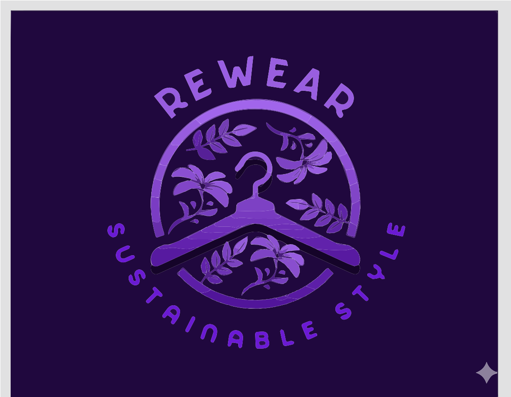

<p align="center">
  
</p>

<h1 align="center">Rewear</h1>

<p align="center">
  Swap secondhand clothes with other members, one listing for one listing.<br />
  List an item, send a swap request, and track every request from your dashboard.
</p>

Rewear is a practice project. It is a Flask app where members swap secondhand clothes. You list an item with a size, a category and a points cost. Other members browse the listings and send a swap request that offers one of their own items. When the owner accepts, the two listings change owners.

It is a server-rendered Flask app with Jinja templates, one SQLite database and Flask-Migrate for the schema. You need Python 3 and nothing else. There are no API keys, paid services or background workers.

## What you get

- **Swap requests trade one listing for another.** On a listing you don't own, you pick one of your own listings to offer. The request stays pending until the owner accepts or declines it, or until you cancel it. The app refuses a second pending request for the same listing, and it refuses to offer an item that is already in another pending request.
- **Accepting a request moves both listings.** The accept route exchanges the owners of the two listings in one database commit and marks the request `completed`. Declined requests stay in the database with status `declined`.
- **A dashboard for both sides of each swap.** `/items/dashboard` lists your listings, the requests you sent, and the requests for your items. Each request has accept, decline or cancel buttons.
- **Points as a price, not a balance you spend yet.** New accounts start with 20 points. Each listing has a points cost, and the listing pages and the dashboard show your balance. Accepting a swap does not deduct or add points.
- **Only owners and admins can change a listing.** The edit, update and delete routes check that you own the listing or have `is_admin` set. The app redirects anyone else with an error message.
- **Hashed passwords and a timed session.** The app stores passwords with Werkzeug's `generate_password_hash`. Registration needs a username of at least 3 characters, a password of at least 6 and an email that is not registered yet. "Remember me" makes the session permanent, and it expires after 3600 seconds.
- **Image links, not uploads.** A listing takes an image URL that the page loads directly. A listing without one shows a bundled placeholder photo.

## Running it

You need Python 3 with `pip`. From the repository root, run:

```sh
python3 -m venv .venv
. .venv/bin/activate
pip install -r requirements.txt
sh script.sh
python run.py
```

Open http://127.0.0.1:5000. The landing page is at `/`, the listings at `/items/` and the login at `/auth/login`.

`script.sh` deletes any existing `instance/` and `migrations/` folders, creates `instance/site.db` through Flask-Migrate, and loads the sample data. Run it before the first start. Without it the database has no tables, and the first query fails with `no such table: users`. Run it again to reset the data.

`python run.py` starts Flask's development server in debug mode on port 5000. Use a production WSGI server for anything public.

Set `SECRET_KEY` in the environment before you run the app anywhere other people can reach it. Without it, sessions are signed with the development key in `app/__init__.py`.

### Sample accounts

`script.sh` creates these accounts:

- `admin@rewear.com` with password `admin123`. This account is an admin with 1000 points.
- `alice@example.com`, `bob@example.com`, `carol@example.com`, `david@example.com`, `emma@example.com` and `frank@example.com`, all with password `password123`.

## How it is built

| File | Role |
| --- | --- |
| `app/__init__.py` | `create_app()` factory. Sets the SQLite URI and `SECRET_KEY`, registers the `auth` blueprint at `/auth` and the `item` blueprint at `/items`, and serves the landing page at `/`. |
| `app/models.py` | `User`, `Item` and `SwapRequest` models. Check constraints limit listing categories and sizes, and swap request statuses. |
| `app/routes/auth.py` | Register, login and logout, plus the `login_required` and `logout_required` decorators. |
| `app/routes/item.py` | Listing pages, the dashboard and the swap routes. |
| `app/templates/` | Jinja templates for each page. |
| `sample_data.py` | Seeds the sample accounts, listings and swap requests that `script.sh` loads. |

## Known gaps

- Listings show up as soon as they are created. The approval status is commented out in `app/models.py`, and the listing index loads every item.
- Nothing changes a points balance after registration, so the points cost is a label for now.
- `app/routes/admin.py` is empty and no admin pages are routed. Admins can only edit or delete listings.
- The app has no password reset, no email confirmation, no CSRF protection on its forms and no tests.
